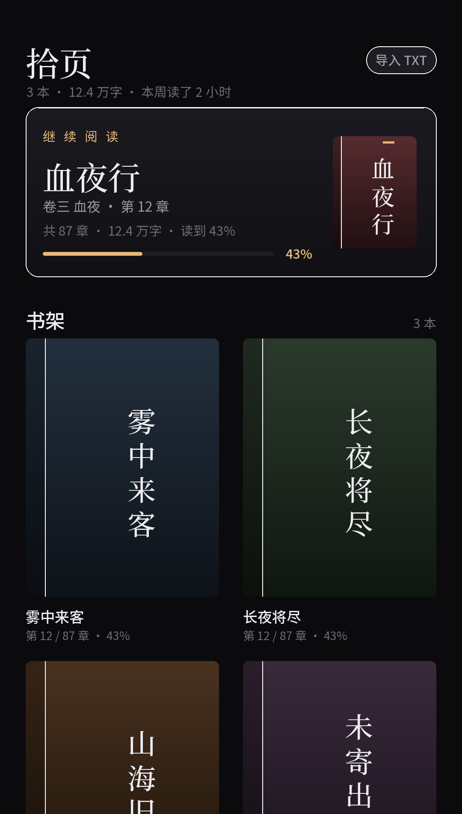

# 拾页 · Shiye Reader

> 一个离线优先的 Android 小说阅读器。导入 → 阅读 → 搜索，全部在本机完成，不联网。



## 下载

**[最新版 APK](https://github.com/linyanquan2026-hub/shiye-reader/releases/latest)** · Android 8.0+ · 约 4.4 MB

> 安装包用调试签名签发，仅供测试；介意的话可以克隆源码自己重签。

## 特性

- **多格式导入**：TXT / Markdown / HTML / EPUB / DOCX / PPTX / PDF（文字版）
- **重排版阅读**：横向翻页（一次手势只翻一页，甩得再快也不会连翻）、字号 4 档、点按收起工具栏
- **阅读背景**：相册选图 + 三档压暗，按书记忆，重启还在
- **全书搜索**：输入字词，列出命中的章节和页码，点一下跳过去并在正文里高亮
- **自动分卷**：按标题主题词和正文词频，把长书切成若干卷，并生成离线摘要
- **书架**：程序生成封面（书名哈希决定配色，不联网）、继续阅读大卡、双列网格、最近在读排序
- **合集**：几本书合并成一本（按《书名》分卷），或者建文件夹分组
- **完全离线**：没有申请任何网络权限，不收集任何数据

## 支持格式

| 格式 | 说明 |
|---|---|
| TXT / Markdown | 自动识别 UTF-8 / GBK / GB18030 |
| HTML | 去脚本样式，按 `h1`/`h2` 或「第 N 章」切分 |
| EPUB | 按 spine 顺序读取，标题取 `<title>` / `<h1>` |
| DOCX | 读 `word/document.xml`，优先用「标题 1/2」样式分章 |
| PPTX | 一页一章，第一行当标题 |
| PDF | 需要文字层；扫描版（纯图片）会明确提示抽不到文字 |

> 阅读器只处理文字：图片、表格样式、扫描版 PDF 都不支持。

## 构建

需要 JDK 17 和 Android SDK 34（`compileSdk 34` / `minSdk 26`）。

```bash
./gradlew assembleDebug
```

产物在 `app/build/outputs/apk/debug/app-debug.apk`。用 Android Studio 直接打开根目录也可以运行。

## 实现要点

- 纯 Java + 原生 View，没有 Compose、没有第三方 UI 库；唯一依赖是 PDF 抽取用的 [pdfbox-android](https://github.com/TomRoush/PdfBox-Android)，APK 因此约 5 MB
- **分页**：`StaticLayout` + 行高切页（`Paginator`），翻页时只重绘当前页那几十行，不重绘整章
- **翻页手势**：一次手势只翻一页；松手判方向 → 动画走完才改页码；章尾继续滑直接进下一章
- **搜索**：全书 `indexOf` 粗扫拿到「共几章几处」，页码再按需分页、每 30 条一批在后台算
- **存储**：正文（`xx.json`）和阅读进度（`xx.progress`）分开写，退出阅读页不会阻塞；书架走进程内缓存
- **背景**：导入时缩放到屏幕尺寸并缓存，每帧只贴一张同尺寸图

## 目录

```
app/src/main/java/app/shelf/
  MainActivity.java    书架 / 合集 / 导入
  ReaderActivity.java  阅读页 / 目录 / 搜索 / 背景
  PageView.java        横向分页视图（手势、绘制、命中高亮）
  Paginator.java       分页算法
  Importer.java        多格式文字抽取
  CoverView.java       程序生成封面
  Store.java           存储与缓存
  TextUtil.java        编码识别、切章、分卷、摘要
```

## 已知限制

- 阅读器是为中文小说优化的，其他语言的排版未专门测试
- 没有在线书城 / 书源，只有本地文件
- 大 PDF 在低端机上抽取可能较慢

## 许可证

[MIT](LICENSE)
